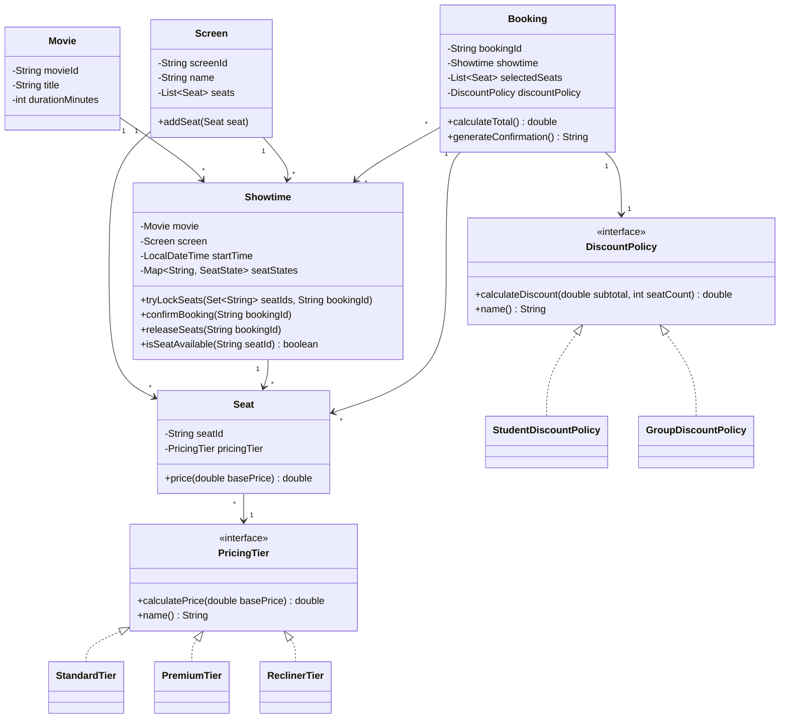

# Class Diagram

## Main responsibilities

- `Movie`: lưu thông tin phim.
- `Screen`: sở hữu danh sách ghế vật lý của một phòng chiếu.
- `Seat`: đại diện cho một ghế và loại giá của ghế đó.
- `Showtime`: gắn phim với phòng chiếu, đồng thời quản lý trạng thái ghế của riêng suất chiếu.
- `Booking`: chứa các ghế đã chọn, tính tổng tiền và tạo confirmation summary.
- `PricingTier`: cung cấp hành vi tính giá theo loại ghế.
- `DiscountPolicy`: cung cấp hành vi tính giảm giá.
