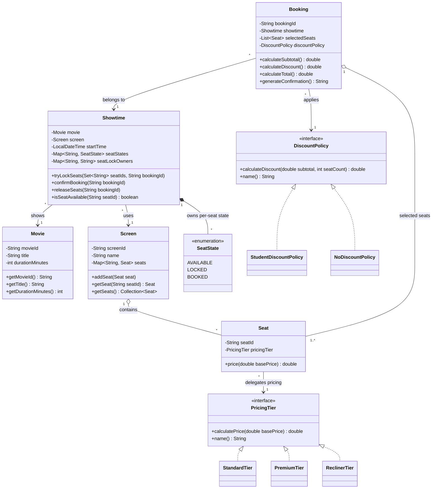

# Class Diagram - Baseline tuần 1

Sơ đồ dưới đây mô tả source code hiện tại, không đưa các class dự kiến của tuần sau vào thiết kế đã hoàn thành.

## Trách nhiệm chính

- `Movie`: lưu thông tin nhận diện, tiêu đề và thời lượng phim.
- `Screen`: quản lý layout ghế vật lý và ngăn mã ghế bị trùng.
- `Seat`: đại diện một ghế và ủy quyền việc tính giá cho `PricingTier`.
- `PricingTier`: abstraction cho thuật toán tính giá; ba implementation tạo ba mức giá.
- `Showtime`: gắn phim, phòng và thời gian; sở hữu trạng thái ghế theo riêng suất chiếu và quản lý lock owner.
- `Booking`: giữ bản sao danh sách ghế đã chọn, tính subtotal/discount/total và tạo confirmation.
- `DiscountPolicy`: abstraction cho quy tắc giảm giá; baseline có student discount và lựa chọn không giảm giá.

## Lưu ý về composition

Trong source tuần 1, `Showtime` không trực tiếp chứa collection `Seat`; nó tham chiếu `Screen`, đọc các seat của screen khi khởi tạo và sở hữu `seatStates`/`seatLockOwners` theo từng mã ghế. Vì vậy sơ đồ chỉ đánh dấu composition đối với state theo suất chiếu, không tuyên bố `Showtime` sở hữu vòng đời của các `Seat` vật lý.

`Booking` tạo một `ArrayList` riêng cho `selectedSeats`, nhưng các phần tử vẫn là reference đến `Seat` từ `Screen`. Đây là object composition theo nghĩa booking được cấu thành từ các ghế đã chọn, không phải ownership tuyệt đối về vòng đời. Điểm này cần được trình bày đúng khi bảo vệ.
