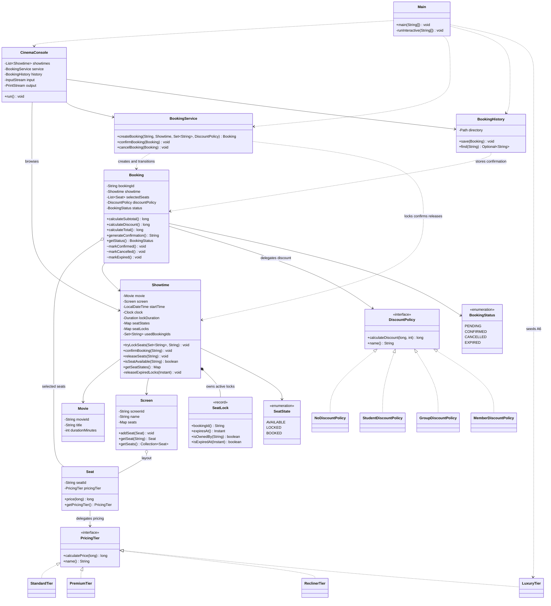

# Class diagram — phiên bản tích hợp tuần 4

Đối chiếu source tại commit `962cf35`, sau khi tích hợp Member discount của Thắng và Luxury tier của Triệu. Sơ đồ liệt kê các field/method chính; constructor, một số getter và tham số kiểu của Map được lược bớt. Đây là tài liệu UML, không thay thế báo cáo tổng kết.

## Quan hệ và trách nhiệm

- **Polymorphism:** `Seat.price()` gọi `PricingTier.calculatePrice()`; `Booking.calculateDiscount()` gọi `DiscountPolicy.calculateDiscount()`. Luxury và Member thêm công thức mới mà không sửa hai call site này.
- **Encapsulation:** `Showtime` giữ các map state/lock và tập ID đã dùng là private. Các method đọc/thay đổi ghế được đồng bộ trên cùng Showtime; snapshot `Map.copyOf()` không cho caller tự sửa ghế. `Booking` giữ status private và chỉ chuyển trạng thái từ PENDING.
- **Object composition/has-a:** Screen giữ layout Seat; Booking giữ collection ghế đã chọn; Showtime sở hữu state/lock theo từng mã ghế. Hình thoi rỗng ở Seat biểu thị reference được chia sẻ: hủy Booking không hủy ghế vật lý. Không diễn giải thành strict lifecycle composition giữa Showtime và các Seat của Screen.
- **SRP:** Console lo nhập/xuất; service điều phối; Booking tính tiền và giữ trạng thái booking; Showtime giữ invariant ghế; BookingHistory lo file. Policy và tier không khóa ghế hoặc lưu file.
- **Phạm vi extension:** Main bổ sung dữ liệu A6/Luxury; CinemaConsole thêm lựa chọn Member. Hai thay đổi này là wiring. Không tuyên bố mọi class cũ đều không đổi; các class nghiệp vụ và interface cũ được giữ nguyên, được kiểm tra trong [diff tích hợp](../evidence/week-4-integration-extensibility-diff.txt).

## Luồng và giới hạn

`createBooking()` tạo Booking rồi giữ ghế; `confirmBooking()` chuyển ghế sang BOOKED và booking sang CONFIRMED; `generateConfirmation()` chỉ hoạt động sau xác nhận. Cancel chỉ áp dụng cho PENDING; confirm sau deadline làm booking EXPIRED. Mốc hết hạn được tính bằng Clock/Duration, không có background timer.

Monitor của Booking bao trọn confirm/cancel; thứ tự khóa nội bộ là Booking rồi Showtime. Bảo vệ này cần các caller dùng chung object trong một JVM. File confirmation không khôi phục inventory/lock khi restart và chưa có transaction chung giữa xác nhận ghế với lưu file.

Sơ đồ [baseline tuần 1](class-diagram.md) và UML trong [báo cáo tuần 3](weekly-report-week-3.md#6-uml-cập-nhật-tuần-3) được giữ làm tài liệu lịch sử.
