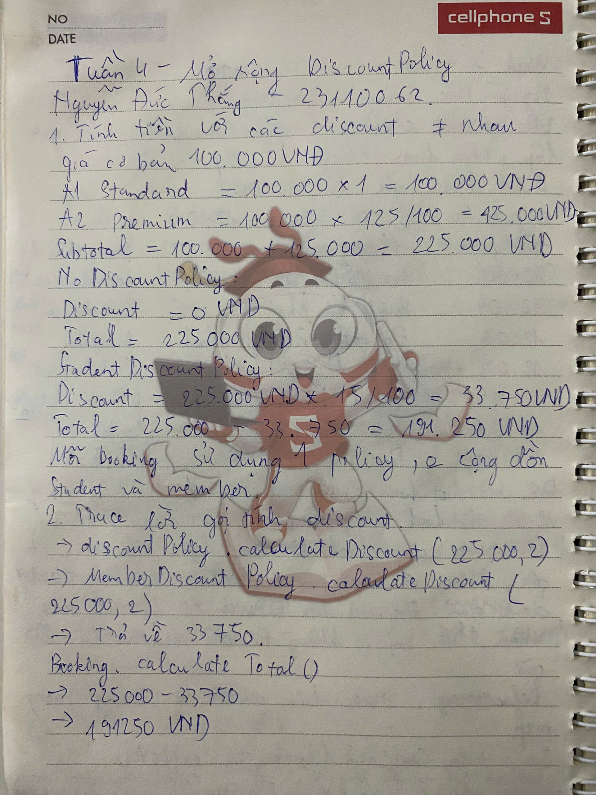
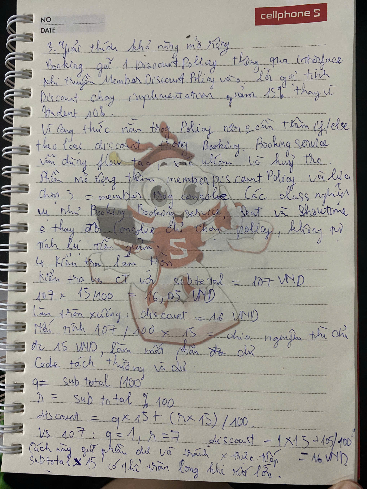

# Tuần 4 — Member discount

Nguyễn Đức Thắng — MSSV 23110062.

Phần chuẩn bị bảo vệ cho chức năng Member discount. Câu trả lời và reflection dưới đây là bản nháp, không phải biên bản vấn đáp.

## Kết quả và phạm vi

`MemberDiscountPolicy` giảm 15% subtotal khi người dùng chọn Member. Mỗi booking nhận đúng một `DiscountPolicy`, không cộng dồn với Student hoặc Group. Đây là lựa chọn mô phỏng; chương trình chưa kiểm tra thẻ thành viên hay tài khoản.

Console giữ các lựa chọn `0 = none`, `1 = student`, `2 = group` và thêm `3 = member`. Giá vẫn được tính trong các object nghiệp vụ, không tính lại trong console.

Với A1 Standard và A2 Premium, giá cơ bản 100.000 VND:

| Policy | Subtotal | Discount | Total |
| --- | ---: | ---: | ---: |
| NoDiscount | 225.000 | 0 | 225.000 |
| Student 10% | 225.000 | 22.500 | 202.500 |
| Member 15% | 225.000 | 33.750 | 191.250 |

Commit tính năng: [4d1dc10](https://github.com/mil352k5-ux/movie-ticket-booking-system/commit/4d1dc10). Commit console: [087ce92](https://github.com/mil352k5-ux/movie-ticket-booking-system/commit/087ce92).

Minh chứng: [kết quả kiểm thử và demo](../evidence/week-4-thang-test-output.txt), [diff mở rộng](../evidence/week-4-thang-extensibility-diff.txt), [AI Usage Log](week-4-thang-ai-usage-log.md).

## Minh chứng viết tay

Hai ảnh do Nguyễn Đức Thắng cung cấp, bổ sung ngày 16/10/2026 và giữ nguyên file gốc.

### Trang 1 — Tính tiền và trace discount



Trang này tính subtotal A1 Standard và A2 Premium là 225.000 VND, sau đó trace lời gọi qua `DiscountPolicy` đến `MemberDiscountPolicy`: giảm 33.750 VND, còn 191.250 VND. Mỗi booking dùng một policy, không cộng dồn Student và Member.

Lưu ý đối chiếu: tiêu đề ngay trước phép tính 15% trên ảnh ghi `StudentDiscountPolicy`, nhưng phép tính và trace bên dưới là của `MemberDiscountPolicy`. Trong code, Student giảm 10%: discount 22.500 VND, total 202.500 VND; Member giảm 15%: discount 33.750 VND, total 191.250 VND.

### Trang 2 — Khả năng mở rộng và làm tròn



Trang này giải thích việc thay implementation qua interface mà không đổi logic Booking/BookingService, cùng vai trò của lựa chọn `3 = member` trong console. Ví dụ riêng cho công thức discount dùng subtotal 107 VND: `q = 1`, `r = 7`, giảm `15 + 105 / 100 = 16` VND với phép chia nguyên.

Các kết quả được đối chiếu với `MemberDiscountBookingTest.swapsPoliciesThroughTheInterfaceWithoutChangingTheBookingFlow()` và `MemberDiscountPolicyTest.roundsDownToWholeVndWithoutDroppingTheRemainderTooEarly()`.

## Self-Explanation

### Polymorphism và mở rộng discount

`MemberDiscountPolicy` implements `DiscountPolicy`. `Booking.calculateDiscount()` gọi `discountPolicy.calculateDiscount(subtotal, seatCount)` qua interface; implementation thực tế quyết định số tiền giảm. `Booking.calculateTotal()` dùng kết quả đó mà không kiểm tra tên hay kiểu policy.

Cách này phù hợp vì các discount khác nhau ở công thức và điều kiện áp dụng, còn việc giữ ghế, xác nhận booking và tạo summary giống nhau. Thêm Member không cần sửa `Booking`, `BookingService`, `Seat`, `Showtime`, interface hoặc các policy cũ. `MemberDiscountBookingTest.swapsPoliciesThroughTheInterfaceWithoutChangingTheBookingFlow()` xác nhận cùng dữ liệu ghế cho ra ba total khác nhau. Mỗi lần dùng một `Showtime` mới để không bị ghế BOOKED hoặc booking ID của lần trước ảnh hưởng.

`CinemaConsole.run()` chỉ thêm nhãn và tạo `new MemberDiscountPolicy()` ở lựa chọn 3. Đây là nơi nối lựa chọn người dùng với implementation, không phải một nhánh tính 15% trong nghiệp vụ. Diff không có nghĩa là toàn bộ ứng dụng không cần sửa: console vẫn phải biết lựa chọn mới để hiển thị nó.

### Encapsulation của trạng thái ghế

`Showtime` tiếp tục giữ `seatStates`, `seatLocks` và `usedBookingIds` là private. Luồng Member đi qua `BookingService.createBooking()` → `Showtime.tryLockSeats()`, sau đó `BookingService.confirmBooking()` → `Showtime.confirmBooking()`. Policy không có quyền đổi trạng thái ghế. Nhờ vậy đổi discount không làm yếu quy tắc chống double-booking. Test `rejectsDoubleBookingEvenWhenTheSecondCustomerChoosesAnotherPolicy()` xác nhận booking thứ hai bị từ chối dù chọn Student thay vì Member.

### Quan hệ has-a và trách nhiệm của class

`Booking` có danh sách `selectedSeats` và một `DiscountPolicy`; `Seat` có một `PricingTier`; `Screen` giữ các ghế vật lý. `Showtime` liên kết Movie/Screen và giữ trạng thái ghế riêng cho suất chiếu. Member chỉ thay cách tính discount được ghép vào Booking, không biến Booking thành một subtype của ghế hay tạo một luồng đặt vé mới. Các object Seat được tham chiếu trong nhiều booking/suất chiếu; quan hệ has-a ở đây không có nghĩa hủy Booking sẽ hủy ghế vật lý.

### Số nguyên VND và làm tròn

`MemberDiscountPolicy.calculateDiscount()` dùng `long` và làm tròn xuống tới 1 VND. Với subtotal không âm, đặt `q = subtotal / 100`, `r = subtotal % 100`, ta có:

```text
floor(subtotal × 15 / 100) = q × 15 + floor(r × 15 / 100)
```

`q × 15` không vượt miền `long`, còn `r` tối đa 99 nên `r × 15` tối đa 1.485. Không nhân subtotal với 15 trước khi chia, và cũng không bỏ phần dư quá sớm. Ví dụ subtotal 107 VND phải giảm 16 VND, không phải 15 VND. Subtotal âm bị từ chối bằng `IllegalArgumentException`.

`MemberDiscountPolicyTest` so sánh kết quả với `BigInteger`, gồm biên `Long.MAX_VALUE` và 2.048 giá trị sinh bằng seed cố định. Đây là các dữ liệu trong một test, không phải 2.048 test JUnit độc lập. Việc kiểm chứng số tiền lớn dành cho policy; không mở rộng cam kết chống tràn sang phép cộng subtotal hoặc các tier/policy cũ.

## 10 câu hỏi chuẩn bị bảo vệ

1. **MemberDiscountPolicy chịu trách nhiệm gì?**

   `calculateDiscount()` tính số tiền giảm 15%, `name()` cung cấp tên để `Booking.generateConfirmation()` hiển thị. Class không giữ ghế, xác nhận booking, lưu file hay xác minh danh tính thành viên.

2. **Polymorphism nằm ở lời gọi nào?**

   `Booking.calculateDiscount()` gọi method của `DiscountPolicy`; cùng lời gọi đó có thể chạy `NoDiscountPolicy`, `StudentDiscountPolicy` hoặc `MemberDiscountPolicy`. Test đổi policy giữ nguyên subtotal 225.000 VND nhưng total lần lượt là 225.000, 202.500 và 191.250 VND.

3. **Vì sao vẫn sửa console nếu nghiệp vụ mở rộng được?**

   Console phải hiển thị và ánh xạ lựa chọn mới. `CinemaConsole.run()` thêm case 3 để tạo policy, nhưng không chứa công thức giảm giá. Các class nghiệp vụ cũ không đổi, được đối chiếu bằng Git diff với baseline `1aa2425`.

4. **Vì sao dùng long thay vì double?**

   Đồ án tính VND nguyên đồng. Số nguyên cho kết quả và quy tắc làm tròn rõ ràng, không phụ thuộc sai số biểu diễn số thực. `long` vẫn có giới hạn nên còn phải chọn thứ tự phép tính an toàn.

5. **Vì sao không viết subtotal * 15 / 100?**

   Với `Long.MAX_VALUE`, tích trung gian bị tràn dù kết quả 15% vẫn vừa `long`. Công thức tách thương và dư cho kết quả 1.383.505.805.528.216.371 VND, khớp `BigInteger`. `subtotal / 100 * 15` cũng chưa đủ vì làm mất phần dư; subtotal 107 là ví dụ phản chứng.

6. **Student và Member có được cộng dồn không?**

   Không. Constructor của `Booking` nhận một policy và console tạo đúng một policy từ lựa chọn. Với A1/A2, Member giảm 33.750 VND và total 191.250 VND, không trừ thêm 22.500 VND của Student.

7. **Test nào chứng minh luồng end-to-end?**

   `MemberDiscountBookingTest.confirmsMemberBookingAndIncludesItsPricingInTheSummary()` kiểm tra PENDING/LOCKED trước confirm và CONFIRMED/BOOKED sau confirm. `CinemaConsoleTest.selectsMemberDiscountConfirmsAndSavesTheSamePricingToHistory()` nhập lựa chọn Member, xác nhận, rồi đọc lại file trong `@TempDir` và đối chiếu số tiền.

8. **Có những trường hợp bị từ chối nào?**

   Subtotal âm bị policy từ chối; booking thứ hai không được lấy ghế đã BOOKED; summary chưa CONFIRMED bị từ chối. Console nhập discount 4 bị từ chối trước khi giữ ghế và không tạo file lịch sử. Cancel Member trả ghế về AVAILABLE, không lưu confirmation.

9. **Hai người cùng đặt ghế cuối thì sao?**

   Nếu dùng chung một object `Showtime`, `Showtime.tryLockSeats()` đồng bộ cả kiểm tra và ghi LOCKED; chỉ một request giữ được ghế. Policy không can thiệp critical section. Hai process hoặc hai object Showtime độc lập không được bảo vệ bằng monitor này; hệ thống nhiều server cần transaction/locking và ràng buộc dữ liệu chung.

10. **Nếu đưa Member vào hệ thống thực tế, còn thiếu gì?**

    Cần kiểm tra điều kiện thành viên trước khi chọn policy, không tin chỉ lựa chọn từ giao diện. Cần lưu trạng thái đặt ghế dùng chung nếu chạy nhiều server hoặc khởi động lại. `BookingHistory` hiện chỉ lưu confirmation; lưu file và xác nhận booking chưa nằm trong một transaction chung.

## Reflection — bản nháp kỹ thuật

Member 15% là biến thể minh họa để kiểm tra khả năng mở rộng discount: khác Student 10% và Group 5%, nhưng dùng lại toàn bộ luồng booking. Phần dễ nhầm là coi phép tính phần trăm là luôn an toàn với `long`. Với subtotal lớn, nhân 15 trước khi chia có thể tràn; với subtotal 107, chia 100 trước rồi chỉ nhân 15 lại làm mất phần dư.

AI hỗ trợ source, tests, ví dụ tính tay và tài liệu. Các kết quả được kiểm tra bằng `BigInteger`, dữ liệu biên và luồng booking thật. Đợt tích hợp phát hiện thêm một điểm yếu ở test Luxury: giả định dấu phẩy phân cách hàng nghìn làm test fail với locale Việt Nam. Việc có test pass ở một cấu hình chưa đủ để kết luận mọi môi trường đều chạy đúng; [log trước/sau sửa](../evidence/week-4-locale-regression.txt) ghi lại cách tìm và xử lý lỗi này.

Điểm cần phân biệt là thêm quy tắc nghiệp vụ với nối nó vào giao diện. Interface giúp `Booking` không phụ thuộc một công thức cụ thể; console vẫn cần lựa chọn mới. Bảy test tích hợp dùng Member cùng Luxury để kiểm tra tính tiền, xác nhận, đặt trùng, cancel, expiration và history mà không sửa lại workflow. Phần policy xử lý được biên lớn không đồng nghĩa mọi phép cộng giá hoặc các tier cũ đều có cùng bảo đảm chống tràn.

Hướng cải tiến là kiểm tra điều kiện thành viên trước khi chọn policy nếu có hệ thống tài khoản thật, chạy test với nhiều locale và giữ một test liên quan cho mỗi thay đổi yêu cầu. Đây là bản nhận xét kỹ thuật để chuẩn bị bảo vệ, chưa xác nhận thay trải nghiệm học tập hoặc kết quả vấn đáp cá nhân. Member hiện vẫn chỉ là lựa chọn mô phỏng, không phải chức năng xác minh thành viên.
