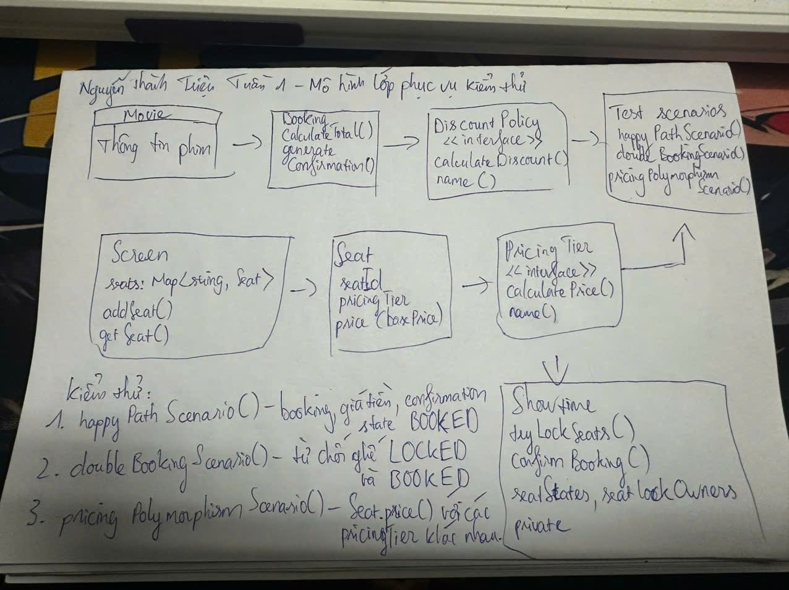
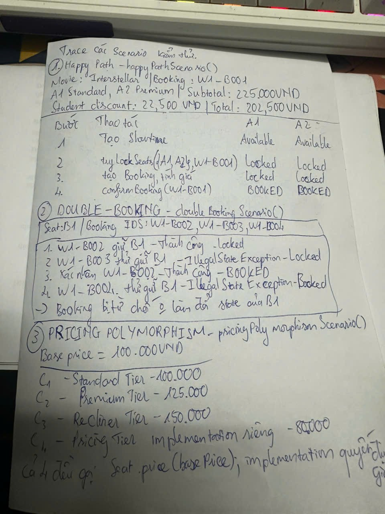
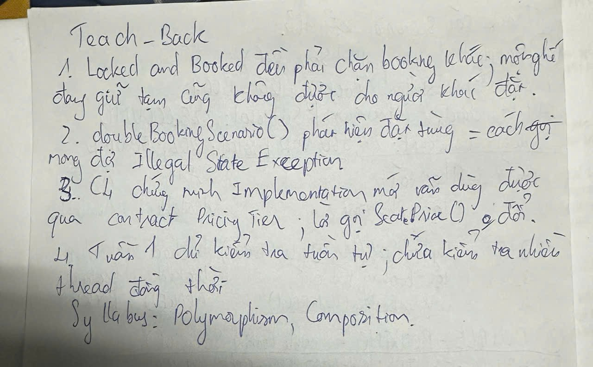

# Tuần 1 - Minh chứng cá nhân của Nguyễn Thành Triệu

- Họ tên: Nguyễn Thành Triệu.
- MSSV: 23110066.
- Nhóm: Movie Ticket Booking System, cùng Nguyễn Đức Thắng.
- Phạm vi: executable scenarios cho happy path, double-booking và pricing polymorphism; hướng dẫn chạy và lưu output tuần 1.
- Nhánh: `week1/trieu-executable-scenarios`.
- Commit triển khai: [4c491df](https://github.com/mil352k5-ux/movie-ticket-booking-system/commit/4c491dfdd6667604e1e56d288d5fdd133b69ea17).
- Ngày cập nhật hồ sơ: 14/10/2026. Các ảnh không ghi ngày vẽ; ngày cập nhật hồ sơ không được dùng làm ngày vẽ.

## Minh chứng viết tay

Phác thảo các lớp, method và ba nhóm kiểm thử. Đây là bản nháp cần hiệu chỉnh, chưa phải UML khớp hoàn toàn với code: mũi tên `Movie → Booking`, `PricingTier → Showtime` và các mũi tên đến ô “Test scenarios” chưa thể hiện đúng quan hệ class; còn thiếu các implementation của hai interface và quan hệ từ `Booking` đến `Showtime` và các `Seat` được chọn. Ảnh gốc được giữ nguyên.

Trace happy path với A1/A2, các lần thử giữ B1 và bảng giá C1-C4. Dòng kết luận ở mép dưới bên phải bị cắt một phần; bảng giá vẫn đọc được và nội dung về cùng contract `PricingTier` được thể hiện tiếp trong ảnh teach-back.

Giải thích vì sao cả `LOCKED` và `BOOKED` phải chặn booking khác, cách scenario mong đợi exception, ý nghĩa của implementation C4 và giới hạn kiểm thử tuần tự. Các ảnh do Triệu cung cấp là bài viết tay; phần diễn đạt và đối chiếu trong báo cáo có Codex hỗ trợ.

## Đối chiếu với source tuần 1

Source được đối chiếu tại commit `4c491df`, sử dụng `double` cho giá tiền. Hồ sơ này không dùng implementation hoặc kết quả kiểm thử tuần 2, tuần 3.

- `happyPathScenario()`: A1 Standard giá 100.000 VND và A2 Premium giá 125.000 VND được khóa cho `W1-B001`. Subtotal là 225.000 VND; student discount 10% là 22.500 VND; total là 202.500 VND. Sau `confirmBooking()`, assertion kiểm tra phim, thời gian, danh sách ghế và total trong confirmation, đồng thời kiểm tra A1/A2 là `BOOKED`. Trong code, việc tính giá để kiểm tra diễn ra sau xác nhận; tính giá trước xác nhận trong trace cho cùng số tiền vì không thay đổi state.
- `doubleBookingScenario()`: `W1-B002` khóa B1; `W1-B003` bị từ chối khi B1 là `LOCKED`. Sau khi xác nhận `W1-B002`, `W1-B004` bị từ chối khi B1 là `BOOKED`. Hai lần từ chối được kiểm tra bằng `assertThrows(IllegalStateException.class, ...)`. Bảng viết tay nêu state không đổi; scenario này không có assertion riêng so sánh state trước/sau từng lần từ chối. Implementation `tryLockSeats()` ném exception trong vòng kiểm tra, trước vòng cập nhật state.
- `pricingPolymorphismScenario()`: với base price 100.000 VND, C1/C2/C3 lần lượt có giá 100.000/125.000/150.000 VND. C4 dùng implementation vô danh của `PricingTier`, trả `basePrice * 0.80`, được kiểm tra là 80.000 VND qua cùng lời gọi `Seat.price()`.

Các mã `W1-B001`, `W1-B002`, `W1-B003`, `W1-B004` trong ảnh tương ứng trực tiếp với mã trong scenario. `Main` dùng mã `B001`/`B002` cho demo riêng, không phải mã của các scenario.

## Liên hệ OOP và kiểm thử

Trong teach-back viết tay, Triệu giải thích C4 vẫn dùng được qua contract `PricingTier` và lời gọi `Seat.price()` không đổi. Code thể hiện điều này vì `Seat` giữ reference kiểu `PricingTier` và gọi `calculatePrice(basePrice)` của implementation được truyền vào.

Triệu cũng ghi rằng ghế `LOCKED` hoặc `BOOKED` đều phải chặn booking khác, `doubleBookingScenario()` phải mong đợi `IllegalStateException`, và tuần 1 chưa kiểm tra nhiều thread đồng thời.

Khi đối chiếu source, các quan hệ thực tế là `Screen` chứa `Map<String, Seat>`, `Booking` chứa `List<Seat>` đã chọn và tham chiếu `Showtime`, còn `Showtime` tham chiếu `Movie`/`Screen` và giữ state/lock owner riêng cho từng suất chiếu. `StandardTier`, `PremiumTier`, `ReclinerTier` triển khai `PricingTier`; `StudentDiscountPolicy` và `NoDiscountPolicy` triển khai `DiscountPolicy`. Không có quan hệ kế thừa giữa `Booking` và `Seat`.

## Kết quả kiểm chứng mới

Ngày 14/10/2026, Codex compile các source tuần 1 và `Week1Scenarios.java` bằng `javac 21.0.10` vào thư mục mới `out/week1-verification-101e448c57ec4055bf771871bc946af7/`, đã được xác nhận là bị Git bỏ qua. Hai chương trình đều chạy bằng class vừa compile, trả exit code 0.

- `cinema.Main`: total 202.500 VND; từ chối giữ lại A1 với thông báo `Rejected correctly: Seat A1 is not available.`
- `cinema.Week1Scenarios`: cả ba scenario thành công; output cuối là `ALL WEEK 1 SCENARIOS PASSED: 3`.

Output đầy đủ của lần chạy mới: [week-1-verification-2026-10-14.txt](../evidence/week-1-verification-2026-10-14.txt). [Output lịch sử](../evidence/week-1-console-output.txt) được giữ nguyên.

## AI Usage Log

| Thời điểm | Công cụ | Prompt/mục đích | Phần AI hỗ trợ | Kiểm chứng và giới hạn |
|---|---|---|---|---|
| Trao đổi trước lần cập nhật này | Codex | Gợi ý bố cục hai trang giấy từ nội dung scenario và teach-back Triệu cung cấp. | Tạo mẫu sơ đồ và trang trace để tham khảo khi viết tay. | Mẫu sơ đồ có mũi tên không khớp source, đã được phát hiện khi đối chiếu ngày 14/10/2026; ảnh phác thảo được ghi rõ cần hiệu chỉnh. Không suy đoán ngày vẽ. |
| 14/10/2026 | Codex | Đọc ảnh viết tay, đối chiếu commit `4c491df` và rubric tuần 1, thêm ảnh và báo cáo cá nhân trên nhánh tuần 1, chạy lại chương trình trước khi commit/push. | Sắp xếp ảnh, viết caption, đối chiếu class/method/scenario, tổng hợp output thực tế; bỏ yêu cầu trả lời thêm bộ ba câu hỏi do Codex đề xuất; không sửa chữ trong ảnh. | Đọc từng ảnh và source tuần 1; so sánh SHA-256 bản sao với ảnh gốc; compile/run trong thư mục build mới. Lần chạy này do Codex thực hiện, không gán cho Triệu. Triệu đã xác nhận email Git và yêu cầu commit/push ảnh nguyên bản; các hạn chế của sơ đồ được ghi rõ trong caption và phần đối chiếu source. |
