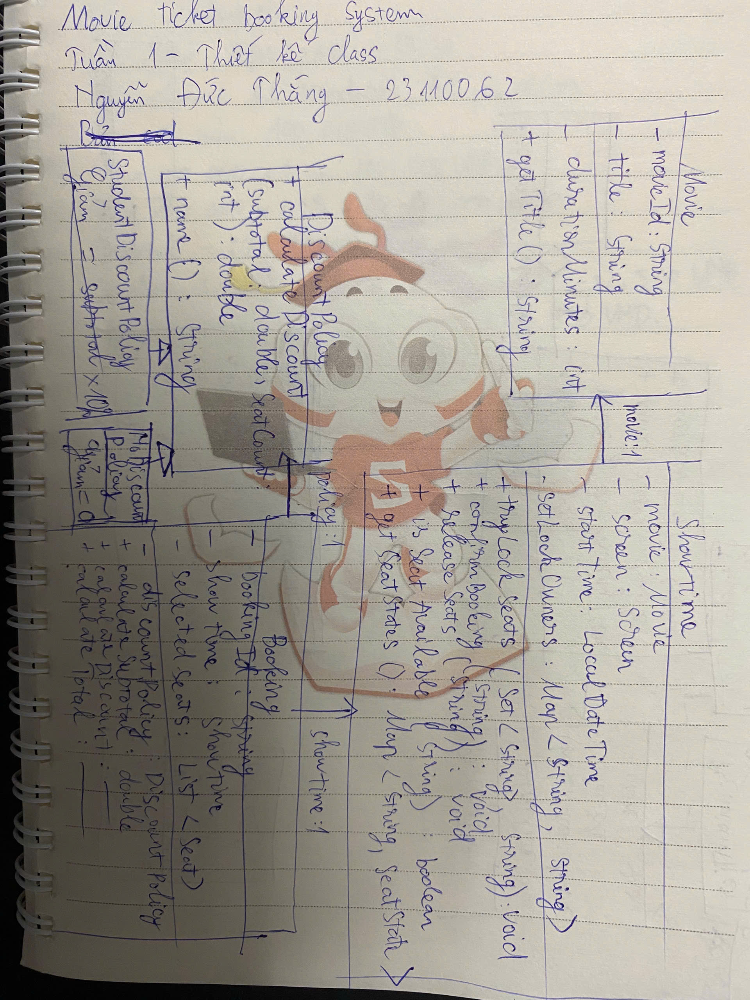
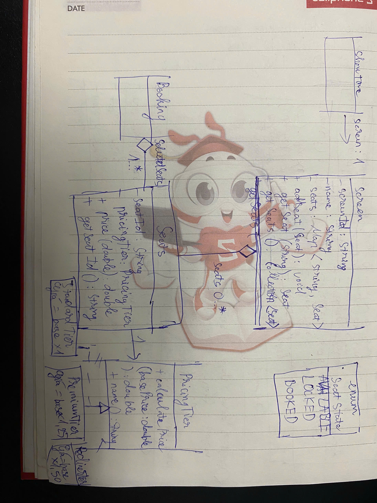
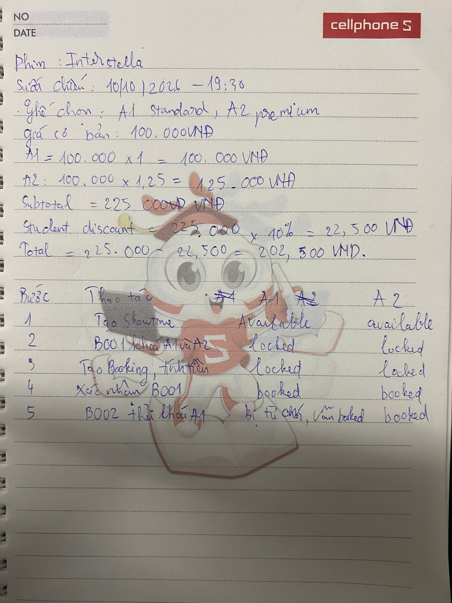

# Báo cáo tuần 1 - Bổ sung sau phản hồi

## 1. Thông tin project

- Project: Movie Ticket Booking System
- Course: OOP - HK1 2026-2027 Đợt 1
- Giảng viên hướng dẫn: Huỳnh Xuân Phụng
- Tuần báo cáo: Tuần 1
- Loại báo cáo: Bổ sung/thay thế báo cáo tuần 1 sau phản hồi của GVHD
- Thành viên:
  - 23110062 - Nguyễn Đức Thắng
  - 23110066 - Nguyễn Thành Triệu
- Repository: https://github.com/mil352k5-ux/movie-ticket-booking-system
- Branch hồ sơ của Nguyễn Đức Thắng: `week1-thang-analysis-report`
- Commits của Nguyễn Đức Thắng:
  - Phân tích phạm vi/use case: https://github.com/mil352k5-ux/movie-ticket-booking-system/commit/a28a551
  - UML, Self-Explanation và báo cáo: https://github.com/mil352k5-ux/movie-ticket-booking-system/commit/9a4f05b
  - Hoàn thiện nội dung branch tuần 1: https://github.com/mil352k5-ux/movie-ticket-booking-system/commit/3b7a8e4
- Branch của Nguyễn Thành Triệu: `week1/trieu-executable-scenarios`
- Commit của Nguyễn Thành Triệu: https://github.com/mil352k5-ux/movie-ticket-booking-system/commit/4c491df
- Merge vào `main`: `1e5eccf` (phần Thắng), `3bbeea8` (phần Triệu)

## 2. Phản hồi cần khắc phục

GVHD yêu cầu repository có source code và commit tương ứng với nội dung báo cáo từng tuần. Bản nộp lại giới hạn ở phạm vi tuần 1, bổ sung tài liệu thiết kế và tách phần việc của hai thành viên thành các branch riêng để thuận tiện đối chiếu.

## 3. Mục tiêu tuần 1

- Hiểu và giới hạn phạm vi bài toán.
- Xác định các use case chính.
- Xây dựng domain model tối thiểu có thể compile/run.
- Thể hiện polymorphism qua seat-tier pricing.
- Để `Showtime` đóng gói trạng thái ghế và ngăn double-booking cơ bản.
- Áp dụng student discount.
- Sinh booking confirmation.
- Chuẩn bị tài liệu giải thích thiết kế và minh chứng chạy.

## 4. Nội dung có thể đối chiếu với source hiện tại

- `Movie`, `Screen`, `Showtime`, `Seat`, `Booking` đã có trong `src/main/java/cinema`.
- `PricingTier` có `StandardTier`, `PremiumTier`, `ReclinerTier`.
- `DiscountPolicy` có `StudentDiscountPolicy`, `NoDiscountPolicy`.
- `Showtime` quản lý `AVAILABLE`, `LOCKED`, `BOOKED` bằng private maps.
- `Main` chạy happy path B001 cho A1/A2 và in confirmation.
- `Main` thử khóa lại A1 cho B002 và bắt `IllegalStateException`.
- `README.md` có hướng dẫn compile/run baseline.

Chi tiết nằm trong [Phân tích bài toán](week-1-problem-analysis.md), [Class diagram](class-diagram.md), [Self-Explanation](week-1-self-explanation.md), [test plan và syllabus mapping](week-1-test-plan-and-syllabus.md) và [AI Usage Log](week-1-ai-usage-log.md).

Các mô tả source trong báo cáo tuần 1 được đối chiếu với hai merge commit
`1e5eccf` và `3bbeea8`. Source trên `main` ở các tuần sau có thể đã được
refactor, vì vậy không dùng trạng thái mới hơn để tuyên bố một tính năng đã có
trong tuần 1.

## 5. Self-Explanation tóm tắt

### Polymorphism

`Seat.price()` gọi `PricingTier.calculatePrice()`. Standard, Premium và Recliner triển khai cùng interface nhưng trả kết quả khác nhau. `Booking.calculateSubtotal()` không cần biết ghế thuộc tier nào, nên có thể thêm tier mới mà không viết lại booking logic.

### Encapsulation

`Showtime` giữ `seatStates` và `seatLockOwners` ở trạng thái private. Chỉ `tryLockSeats()`, `confirmBooking()` và `releaseSeats()` được thay đổi state. Việc tập trung validation trong `Showtime` ngăn code bên ngoài bỏ qua quy tắc và tự đặt ghế.

### Composition

`Screen` chứa các `Seat`; `Showtime` tham chiếu `Screen` và sở hữu state tương ứng với mỗi mã ghế; `Booking` chứa một list riêng của các ghế được chọn. Baseline chưa thể hiện strict composition `Showtime`–`Seat`, vì vậy nhóm ghi rõ giới hạn này thay vì tuyên bố ownership không có trong code.

## 6. Phân công tuần 1

| Thành viên | Phạm vi | Trạng thái/bằng chứng |
|---|---|---|
| Nguyễn Đức Thắng | Phân tích yêu cầu, use case, traceability, UML, Self-Explanation và báo cáo tuần 1 nộp lại. | Branch `week1-thang-analysis-report`; commits `a28a551`, `9a4f05b`, `3b7a8e4`. |
| Nguyễn Thành Triệu | Viết executable scenarios cho happy path, double-booking và pricing polymorphism; cập nhật hướng dẫn chạy và lưu output. | Branch `week1/trieu-executable-scenarios`; commit `4c491df`. |
| Cả hai | Review chéo code/tài liệu, chạy kiểm chứng và chuẩn bị trả lời bảo vệ. | Thực hiện sau khi hoàn thành hai phần việc cá nhân. |

## 7. Minh chứng chạy baseline

Lệnh PowerShell:

```powershell
New-Item -ItemType Directory -Force out | Out-Null
javac -d out src/main/java/cinema/*.java
java -cp out cinema.Main
```

Kết quả đối chiếu với [output chạy thật tại bản tích hợp tuần 1](https://github.com/mil352k5-ux/movie-ticket-booking-system/blob/3bbeea8/evidence/week-1-console-output.txt):

```text
=== HAPPY PATH ===
Booking confirmed successfully.
Booking ID: B001
Movie: Interstellar
Seats: A1, A2
Subtotal: 225,000 VND
Discount (Student discount 10%): 22,500 VND
Total: 202,500 VND

=== VALIDATION: DOUBLE BOOKING ===
Rejected correctly: Seat A1 is not available.
```

Executable scenarios độc lập và evidence file được bổ sung trong phần việc
của Nguyễn Thành Triệu. Xem [source scenario tuần 1](https://github.com/mil352k5-ux/movie-ticket-booking-system/blob/3bbeea8/src/test/java/cinema/Week1Scenarios.java).

## 8. Test plan và syllabus mapping

- Test plan phân biệt scenario đã chạy và scenario mới ở mức dự kiến tại
  [week-1-test-plan-and-syllabus.md](week-1-test-plan-and-syllabus.md).
- Theo Appendix A, Project 12 phải thể hiện `Polymorphism`, `Composition`, seat
  tiers, locking và discounts; question family là `POLY`.
- Worked example: Standard 100.000 VND + Premium 125.000 VND, student discount
  10%, total 202.500 VND.

## 9. Phần vẽ tay và giải thích của Nguyễn Đức Thắng

Tôi vẽ lại class diagram theo source tuần 1 trên hai trang giấy. Trang thứ ba
là phép tính cho booking B001 và trace trạng thái A1, A2 từ `AVAILABLE` đến
`LOCKED`, `BOOKED`; sau đó B002 thử khóa lại A1 và bị từ chối.

**Ảnh 1 - Movie, Showtime, Booking và DiscountPolicy**



**Ảnh 2 - Screen, Seat, SeatState và PricingTier**



**Ảnh 3 - Phép tính giá và trace khóa ghế**



### Điều tôi hiểu từ phần đã làm

**Polymorphism.** `Booking.calculateSubtotal()` chỉ gọi `Seat.price(BASE_PRICE)`, còn
`Seat` chuyển việc tính giá cho `PricingTier.calculatePrice()`. Vì vậy A1 dùng
`StandardTier` có giá 100.000 VND, A2 dùng `PremiumTier` có giá 125.000 VND
nhưng Booking vẫn dùng cùng một cách tính. Nếu thêm loại ghế mới, tôi chỉ cần
thêm một class triển khai `PricingTier`, không phải sửa cách cộng tiền trong
Booking.

**Encapsulation.** Hai map `seatStates` và `seatLockOwners` được giữ private
trong `Showtime`. Mọi thay đổi phải đi qua `tryLockSeats()`,
`confirmBooking()` hoặc `releaseSeats()`. Nếu code bên ngoài tự đổi A1 từ
`BOOKED` về `AVAILABLE`, một booking khác có thể đặt lại A1 và gây trùng ghế.

**Quan hệ has-a.** `Screen` có danh sách ghế và `Booking` có danh sách ghế đã
chọn. Booking không phải là một Seat vì một booking còn có mã booking, suất
chiếu, chính sách giảm giá và có thể gồm nhiều ghế. Các Seat vẫn thuộc layout
của Screen; xóa một booking không có nghĩa là xóa ghế khỏi phòng chiếu.

**Trạng thái theo suất chiếu.** A1 có thể đã được đặt ở suất 19:30 nhưng vẫn
trống ở suất 22:00. Vì vậy mỗi `Showtime` quản lý map trạng thái riêng thay vì
đặt một trạng thái dùng chung trong `Seat`. Trace ở ảnh 3 cho thấy sau khi B001
xác nhận, A1 và A2 ở trạng thái `BOOKED`, nên B002 không thể khóa lại A1.

## 10. Giới hạn tuần 1

- Chưa có automated test framework như JUnit; tuần 1 dùng executable scenario
  tự chứa assertion trong `Week1Scenarios`.
- Chưa có group discount.
- Chưa có lock expiration.
- Chưa có concurrency test thật với nhiều thread.
- Chưa có database transaction cho nhiều server.
- Chưa có catalog/menu tương tác hoặc GUI.
- Quan hệ composition `Showtime`–`Seat` cần được làm rõ hơn.

## 11. Kế hoạch tuần 2

- Thiết lập build/test tự động.
- Kiểm thử Standard, Premium và Recliner.
- Bổ sung group discount từ 5 ghế.
- Bổ sung validation cho dữ liệu domain và booking không hợp lệ.
- Cập nhật class diagram theo implementation thực tế.

## 12. AI Usage Log

- Công cụ: ChatGPT/Codex; model hiển thị ở lần nộp đầu: GPT-5.6.
- Mục đích: gợi ý bố cục báo cáo, kiểm tra sự phù hợp giữa yêu cầu với class/method và rà soát class diagram.
- Prompt tóm tắt: đối chiếu source Movie Ticket Booking System với yêu cầu tuần 1 và đề xuất cấu trúc problem analysis, UML, traceability, Self-Explanation.
- Kết quả sử dụng: nhóm tham khảo bố cục và các điểm cần kiểm tra; Nguyễn Đức Thắng đối chiếu nội dung với source và chịu trách nhiệm kiểm tra lại trước khi nộp.
- Điểm AI còn thiếu được phát hiện: kế hoạch đầu chưa yêu cầu ảnh vẽ tay, worked example và syllabus mapping do nhóm chưa cung cấp rubric. Nhóm bổ sung các mục này sau khi đọc rubric chính thức.
- Cách kiểm chứng: compile/run source, chạy ba scenario, đối chiếu output và Git history. Chi tiết ở [week-1-ai-usage-log.md](week-1-ai-usage-log.md).
