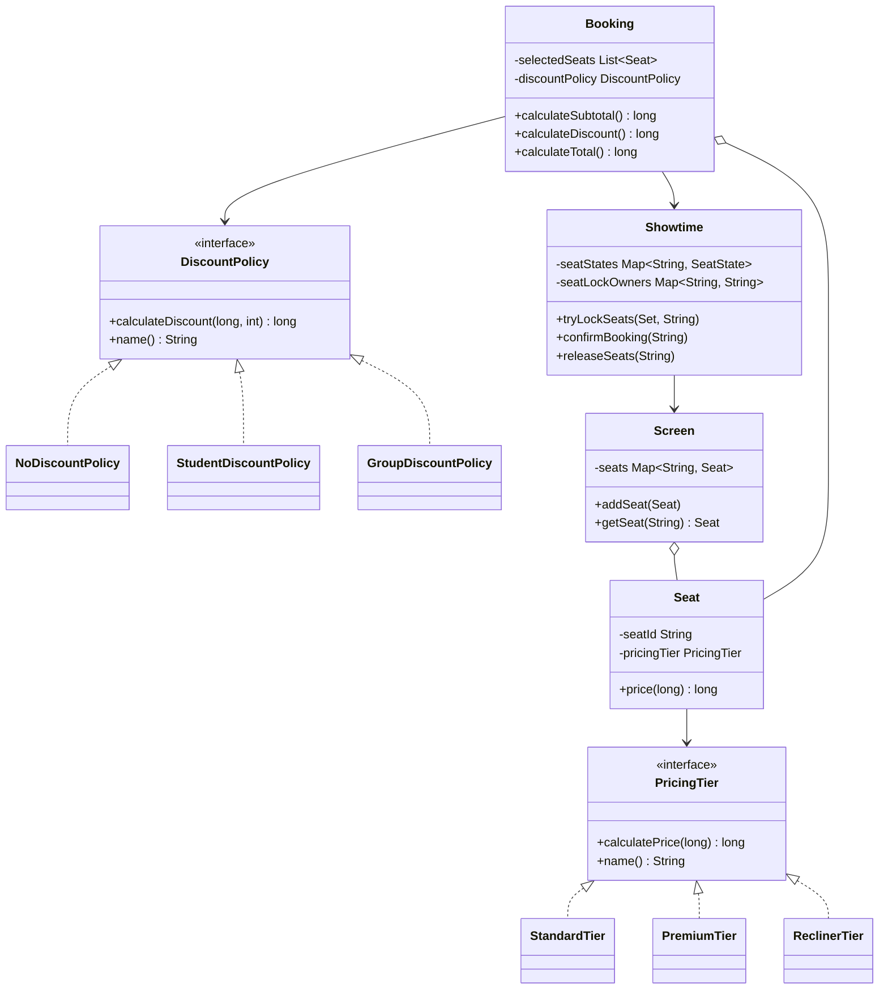

# Báo cáo tiến độ tuần 2

## 1. Thông tin

- Đề tài: Movie Ticket Booking System.
- Thành viên: Nguyễn Đức Thắng - 23110062; Nguyễn Thành Triệu - 23110066.
- GVHD: Huỳnh Xuân Phụng.
- Nhánh của Thắng: `week2-thang-pricing-tests`.
- Nhánh của Triệu và bản tích hợp cuối tuần 2:
  `week2-trieu-discount-validation`.

## 2. Công việc đã hoàn thành

Tuần 2 tập trung chuyển bản demo tuần 1 thành project có build và test tự động.
Nhóm đã hoàn thành các phần sau:

- Thiết lập Maven, Java 17 và JUnit 5.
- Đổi toàn bộ tiền VND từ `double` sang `long`.
- Kiểm thử ba loại ghế Standard, Premium và Recliner qua cùng interface
  `PricingTier`.
- Kiểm thử subtotal, student discount và trường hợp không giảm giá.
- Thêm `GroupDiscountPolicy`: giảm 5% khi booking có từ 5 ghế.
- Thêm validation cho dữ liệu domain và các thao tác khóa ghế không hợp lệ.
- Kiểm tra tính all-or-nothing khi khóa nhiều ghế.

## 3. Phân công và commit

| Thành viên | Phần việc | Commit |
|---|---|---|
| Nguyễn Đức Thắng | Thiết lập Maven và JUnit 5 | [`c9e61bc`](https://github.com/mil352k5-ux/movie-ticket-booking-system/commit/c9e61bc) |
| Nguyễn Đức Thắng | Đổi kiểu tiền từ `double` sang `long` | [`7b14e1a`](https://github.com/mil352k5-ux/movie-ticket-booking-system/commit/7b14e1a) |
| Nguyễn Đức Thắng | Test pricing polymorphism và booking price | [`2038061`](https://github.com/mil352k5-ux/movie-ticket-booking-system/commit/2038061) |
| Nguyễn Thành Triệu | Group discount, validation và test lỗi | [`047199f`](https://github.com/mil352k5-ux/movie-ticket-booking-system/commit/047199f) |

Nhánh của Thắng được tích hợp bằng commit
[`3ec51ff`](https://github.com/mil352k5-ux/movie-ticket-booking-system/commit/3ec51ff),
sau đó Triệu tiếp tục từ bản tích hợp này. Vì vậy lịch sử Git thể hiện được
phần code của từng người và thứ tự thực hiện.

## 4. Thiết kế sau tuần 2



`Seat.price(long)` không kiểm tra tên tier mà gọi
`PricingTier.calculatePrice(long)`. Tương tự,
`Booking.calculateDiscount()` chỉ làm việc với `DiscountPolicy`. Do đó có thể
thay subtype mà không viết lại logic trong `Seat` hoặc `Booking`.

## 5. Invariant và encapsulation

- `Movie` không nhận ID/title rỗng và duration không dương.
- `Screen.addSeat()` không nhận `null` và không cho trùng seat ID.
- `Seat` không nhận seat ID rỗng hoặc `PricingTier` bằng `null`.
- `Booking` yêu cầu booking ID, showtime, danh sách ghế và discount policy hợp
  lệ; ghế phải tồn tại trong Screen.
- `Showtime.tryLockSeats()` kiểm tra toàn bộ danh sách trước rồi mới đổi state.
  Nếu một ghế không hợp lệ hoặc không còn trống, các ghế còn lại không bị khóa
  dở dang.

Các field giữ invariant đều là `private`. Nếu `Screen.seats` hoặc
`Showtime.seatStates` là public, code bên ngoài có thể thêm ghế trùng hoặc đổi
`BOOKED` về `AVAILABLE` mà bỏ qua validation, dẫn đến double-booking.

## 6. Kết quả kiểm thử

Lệnh chạy:

```powershell
mvn clean test
```

| Test class | Số test | Nội dung chính |
|---|---:|---|
| `PricingTierTest` | 2 | Ba tier và khả năng thay subtype mới |
| `BookingPricingTest` | 2 | Subtotal, student discount, no discount |
| `GroupDiscountPolicyTest` | 5 | Biên 4/5/6 ghế và thay discount policy |
| `DomainValidationTest` | 15 | Dữ liệu sai, ghế lạ, all-or-nothing, double-booking |
| **Tổng** | **24** | **24 pass, 0 failure, 0 error** |

Output Maven chạy ngày 11/10/2026 được lưu tại
[`evidence/week-2-test-output.txt`](../evidence/week-2-test-output.txt). Khi rà
soát lại ngày 14/10/2026, hai nhánh vẫn compile được: nhánh Thắng có 4/4 test
pass và bản tích hợp có 24/24 test pass.

## 7. Giải trình cá nhân

### Nguyễn Đức Thắng - pricing và automated tests

Phần tôi phụ trách bảo vệ tính đúng của tiền vé. Ban đầu code dùng `double`,
nhưng VND trong bài không cần phần thập phân và phép so sánh test cần kết quả
chính xác. Tôi đổi `PricingTier`, `DiscountPolicy`, `Seat` và `Booking` sang
`long`; các phép nhân tỷ lệ dùng số nguyên và làm tròn xuống đến 1 VND.

`PricingTierTest.acceptsANewPricingTierThroughTheSameContract()` tạo một
implementation mới trả 80% giá gốc. Test vẫn gọi `Seat.price()` như với
Standard/Premium/Recliner, chứng minh `Seat` phụ thuộc interface chứ không phụ
thuộc class cụ thể. `BookingPricingTest` kiểm tra 100.000 + 125.000 = 225.000
VND, student discount 22.500 VND và total 202.500 VND.

Nếu `Seat.pricingTier` là public hoặc cho phép bằng `null`, giá ghế có thể bị
đổi tùy ý hoặc `Seat.price()` lỗi khi đang tính booking. Vì vậy field này là
`private final` và constructor kiểm tra dữ liệu ngay lúc tạo object.

### Nguyễn Thành Triệu - discount và validation

Phần Triệu phụ trách bảo vệ các điều kiện hợp lệ của domain và bổ sung giảm giá
nhóm. `GroupDiscountPolicy.calculateDiscount()` chỉ trả 5% khi `seatCount >= 5`.
Các test ở mốc 4, 5 và 6 ghế kiểm tra đúng ranh giới của quy tắc này.

Validation được đặt tại constructor hoặc method đang sở hữu dữ liệu. Ví dụ,
`Screen.addSeat()` kiểm tra ghế trùng, còn `Showtime.tryLockSeats()` kiểm tra
state và cập nhật khóa. Nếu các map là public, caller có thể bỏ qua những kiểm
tra đó. Test `lockingMultipleSeatsIsAllOrNothing()` khóa A1 trước, sau đó thử
khóa A1 và A2 cho booking khác; thao tác bị từ chối và A2 vẫn `AVAILABLE`.

## 8. Phản biện kết quả AI

Baseline tuần 1 có AI hỗ trợ nhưng dùng `double` cho tiền. Kiểu này không phù
hợp với VND nguyên và có thể tạo sai số khi nhân phần trăm. Điểm yếu được thấy
khi viết assertion chính xác cho 100.000, 125.000 và 22.500 VND. Nhóm không giữ
nguyên gợi ý ban đầu mà đổi toàn bộ contract tính tiền sang `long` rồi dùng test
để kiểm tra lại.

Baseline cũng mới chạy happy path, chưa bảo vệ nhiều input lỗi. Khi viết
negative tests, nhóm phát hiện constructor và thao tác khóa ghế còn nhận dữ liệu
rỗng/null. Triệu bổ sung validation tại class sở hữu dữ liệu thay vì gom vào
một class tiện ích, nhờ đó invariant được giữ ngay tại biên của object.

Chi tiết prompt, phần AI hỗ trợ và cách kiểm tra được ghi trong
[AI Usage Log tuần 2](week-2-ai-usage-log.md).

## 9. Liên hệ nội dung môn học

| Nội dung OOP | Vị trí trong code tuần 2 | Ý nghĩa trong bài |
|---|---|---|
| Encapsulation | Private fields; validation trong constructor/method | Không cho object tồn tại ở trạng thái sai |
| Polymorphism | `PricingTier`, `DiscountPolicy` | Thay loại giá/giảm giá mà không sửa Booking |
| Abstraction | Hai interface trên | Booking chỉ biết contract cần dùng |
| Composition/has-a | `Screen` có Seat; `Booking` có selected Seats | Ghép object theo trách nhiệm thay vì kế thừa sai nghĩa |
| Exception handling | `IllegalArgumentException`, `IllegalStateException` | Phân biệt dữ liệu sai với thao tác sai trạng thái |
| Unit testing | Bốn test class JUnit | Kiểm tra happy path, boundary và invalid operation |

## 10. Điểm còn lại sau tuần 2

- Seat lock chưa tự hết hạn.
- Chưa có test nhiều thread cùng tranh một ghế.
- Chưa có database transaction hoặc persistence.
- Chưa quản lý trạng thái vòng đời của Booking bằng service riêng.

Các nội dung này được chuyển sang kế hoạch tuần 3.
