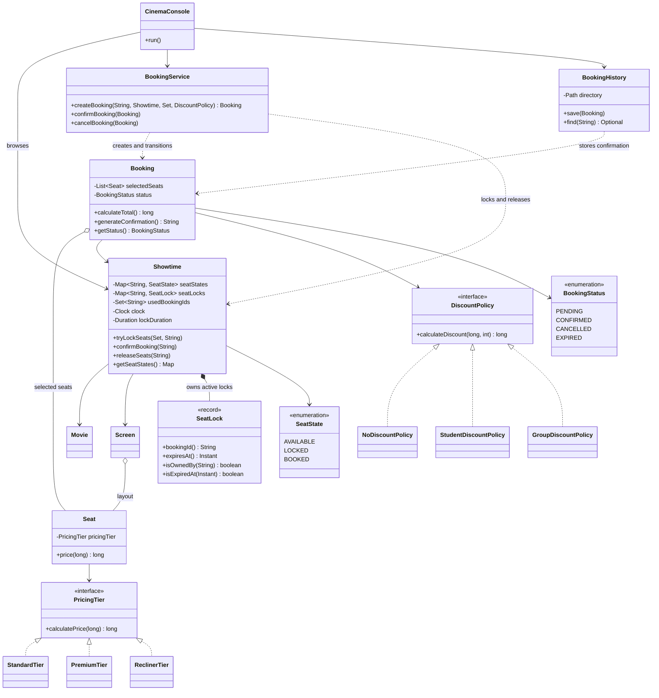
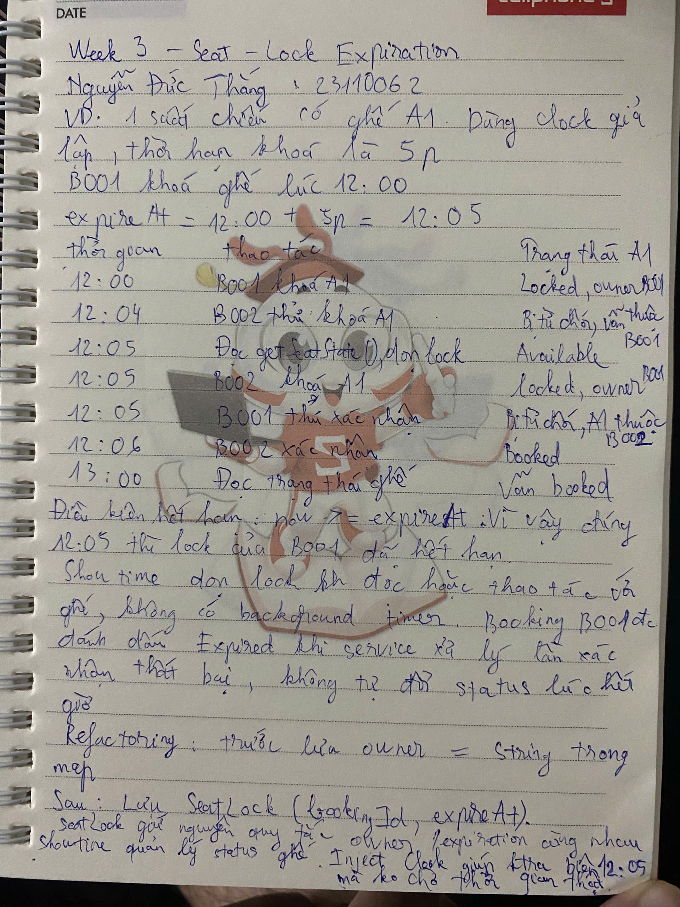
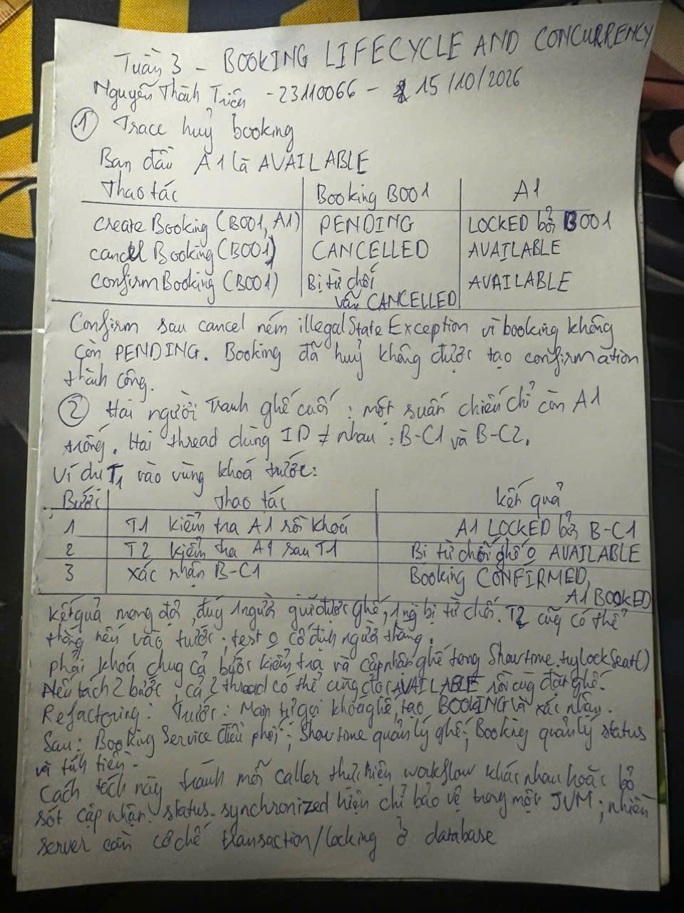

# Báo cáo tiến độ tuần 3 - Movie Ticket Booking System

Nguyễn Đức Thắng - 23110062; Nguyễn Thành Triệu - 23110066.
GVHD: Huỳnh Xuân Phụng.

## 1. Mục tiêu và kết quả

Tuần 3 hoàn thiện luồng đặt vé sau phần pricing/validation của tuần 2:
khóa ghế có thời hạn, quản lý trạng thái booking, kiểm thử đồng thời, lưu lịch
sử xác nhận bằng file và bổ sung console để duyệt phim/suất chiếu, chọn ghế.

Các trường hợp lỗi được phân biệt bằng `IllegalArgumentException` cho input,
`IllegalStateException` cho thao tác sai trạng thái và `IOException` cho lỗi
lưu/đọc file. Bộ test cuối tuần có 66 test thành công; ba scenario tuần 1 vẫn
chạy đúng.

## 2. Phân công và lịch sử Git

| Thành viên | Công việc | Commit |
|---|---|---|
| Thắng | `SeatLock`, TTL 5 phút, injected `Clock`/`Duration`, snapshot trạng thái | [`9bf4de4`](https://github.com/mil352k5-ux/movie-ticket-booking-system/commit/9bf4de4) |
| Thắng | Test expiration, owner, biên thời gian và all-or-nothing | [`ae55bb3`](https://github.com/mil352k5-ux/movie-ticket-booking-system/commit/ae55bb3) |
| Thắng | Tài liệu lifecycle và output test | [`91caf56`](https://github.com/mil352k5-ux/movie-ticket-booking-system/commit/91caf56), [`d0f7488`](https://github.com/mil352k5-ux/movie-ticket-booking-system/commit/d0f7488) |
| Triệu | `BookingService`, `BookingStatus`, 9 lifecycle tests và test tranh ghế cuối | [`1eab3dc`](https://github.com/mil352k5-ux/movie-ticket-booking-system/commit/1eab3dc) |
| Thắng - phần bổ sung khi rà soát | Khóa trọn confirm/cancel, kiểm tra confirmation và booking ID trùng | [`702ba74`](https://github.com/mil352k5-ux/movie-ticket-booking-system/commit/702ba74) |
| Thắng - phần bổ sung khi rà soát | `BookingHistory`, lưu/đọc file UTF-8 và 8 test I/O | [`af75703`](https://github.com/mil352k5-ux/movie-ticket-booking-system/commit/af75703) |
| Thắng - phần bổ sung khi rà soát | Console chọn suất chiếu, ghế, discount; 3 test end-to-end | [`f3ddfda`](https://github.com/mil352k5-ux/movie-ticket-booking-system/commit/f3ddfda) |
| Thắng - phần bổ sung khi rà soát | Chỉnh giờ chiếu mẫu để hai phim cùng Screen không trùng nhau | [`1e6dfed`](https://github.com/mil352k5-ux/movie-ticket-booking-system/commit/1e6dfed) |

Hai nhánh implementation là `week3-thang-seat-lock-expiration` và
`week3-trieu-booking-concurrency`. Phần Thắng được tích hợp vào main ở
[`4097367`](https://github.com/mil352k5-ux/movie-ticket-booking-system/commit/4097367),
phần Triệu ở
[`cf8f68c`](https://github.com/mil352k5-ux/movie-ticket-booking-system/commit/cf8f68c).
Các bổ sung khi rà soát được thực hiện tiếp trên nhánh tuần 3 cũ của Thắng.

## 3. Refactoring trước và sau

### 3.1. Từ owner ID sang SeatLock

Tuần 2 chỉ lưu người giữ ghế:

```java
private final Map<String, String> seatLockOwners = new HashMap<>();
seatLockOwners.put(seatId, bookingId);
```

Tuần 3 lưu cả owner và thời hạn:

```java
private final Map<String, SeatLock> seatLocks = new HashMap<>();
Instant expiresAt = now.plus(lockDuration);
seatLocks.put(seatId, new SeatLock(bookingId, expiresAt));
```

`SeatLock.isOwnedBy()` và `isExpiredAt()` giữ quy tắc của một lock trong value
object bất biến. `Showtime` tiếp tục sở hữu và cập nhật state theo từng ghế.
Inject `Clock` giúp test tiến thời gian ngay, không cần chờ 5 phút thật.

### 3.2. Từ thao tác rời rạc sang BookingService

Luồng cũ của Main:

```java
showtime.tryLockSeats(firstSeats, firstBookingId);
Booking booking = new Booking(firstBookingId, showtime, firstSeats, policy);
showtime.confirmBooking(firstBookingId);
```

Luồng mới:

```java
Booking booking = service.createBooking(firstBookingId, showtime, firstSeats, policy);
service.confirmBooking(booking);
System.out.println(booking.generateConfirmation());
```

Service điều phối việc giữ/xác nhận/hủy ghế và cập nhật `BookingStatus`. Main
và `CinemaConsole` chỉ xử lý tương tác, không tự sửa map hay lặp lại logic giá.

`confirmBooking()` và `cancelBooking()` khóa cùng object Booking xuyên suốt
bước kiểm tra `PENDING`, cập nhật ghế và chuyển trạng thái. Getter/setter được
đồng bộ riêng lẻ chưa đủ để bảo vệ một workflow gồm nhiều bước.

## 4. Self-Explanation

### Nguyễn Đức Thắng - seat-lock expiration và phần bổ sung

`SeatLock` chứa `bookingId` và `expiresAt`; `isExpiredAt(now)` trả true khi
`now >= expiresAt`. Tôi chọn lưu thời hạn trong object riêng để mỗi lock có
quy tắc rõ ràng và không phải duy trì hai map owner/expiration song song.

`Showtime.releaseExpiredLocks()` được gọi khi đọc hoặc thao tác với ghế. Nếu
không có request, hệ thống không chạy background timer; lần truy cập tiếp
theo sẽ dọn lock quá hạn. Ghế `BOOKED` không bị trả lại khi thời gian trôi qua.

`seatStates`, `seatLocks`, `usedBookingIds` là private. `getSeatStates()` trả
`Map.copyOf()` để caller có snapshot không sửa được. Nếu trả map mutable,
caller có thể đổi ghế đã đặt về trống và bỏ qua quy tắc chống đặt trùng.

`BookingHistory` chỉ lưu/đọc xác nhận; nó không tính giá hoặc điều phối giữ
ghế. File dùng UTF-8, booking ID được mã hóa thành tên file và xác nhận khác
cùng ID bị từ chối thay vì ghi đè. Lỗi I/O không đổi booking đã xác nhận về
`PENDING`; người dùng nhận được thông báo lỗi lưu lịch sử.

### Nguyễn Thành Triệu - BookingService và concurrency

`Booking` giữ trạng thái riêng; chỉ chuyển từ `PENDING` sang `CONFIRMED`,
`CANCELLED` hoặc `EXPIRED`. `EXPIRED` được đánh dấu khi confirm phát hiện lock
đã hết hạn, không tự thay đổi ngay lúc đồng hồ đi qua deadline.

`BookingService` giữ workflow, còn `Showtime` giữ trạng thái ghế. Service gọi
method của Showtime bằng booking ID, không truy cập trực tiếp map. Việc
khóa và xác nhận được tách khỏi `PricingTier`/`DiscountPolicy` nên bổ sung
lifecycle không phải viết lại cách tính tiền.

Trước đây Main tự gọi các bước khóa ghế, tạo booking và xác nhận. Tôi tách
workflow sang BookingService để mỗi caller dùng cùng một đường đi, tránh
bỏ sót cập nhật BookingStatus. Đây là áp dụng SRP vào đúng điểm thay đổi:
Main lo tương tác, Service lo thứ tự các bước, Showtime lo invariant ghế.

`BookingConcurrencyTest.onlyOneUserCanBookTheLastSeat()` dùng hai worker,
`CountDownLatch` để bắt đầu cùng thời điểm và kiểm tra đúng một booking thành
công, một booking bị từ chối. Test không mặc định user 1 thắng. Sau khi xác
nhận người thắng, A1 phải là `BOOKED` và booking là `CONFIRMED`.

`synchronized` trên Showtime bảo vệ check-and-lock trong một JVM. Với nhiều
server, cần database transaction, row-level lock hoặc unique constraint cho
cặp suất chiếu/ghế; khóa Java trong bộ nhớ không thay thế được cơ chế đó.

### Các nguyên lý dùng trong phiên bản tuần 3

- Polymorphism: `Seat.price()` gọi `PricingTier.calculatePrice()`;
  `Booking.calculateDiscount()` gọi `DiscountPolicy.calculateDiscount()`.
  Console chọn policy rồi service dùng cùng workflow cho mọi policy.
- Encapsulation: private state/maps trong Showtime và private status trong
  Booking; thay đổi đi qua method có kiểm tra trạng thái và chủ sở hữu.
- Object composition/has-a: Screen chứa Seat; Booking chứa selected Seats;
  Showtime sở hữu lock/state riêng cho mỗi ghế. Seat vật lý được chia sẻ theo
  layout Screen, còn trạng thái đặt vé độc lập theo suất chiếu.
- SRP: CinemaConsole xử lý nhập/xuất, BookingService điều phối, Booking tính
  tiền và bảo vệ status, BookingHistory xử lý file, Showtime quản lý ghế.

## 5. Minh chứng test và phản biện AI

| Test class | Số test |
|---|---:|
| `BookingPricingTest` | 2 |
| `PricingTierTest` | 2 |
| `GroupDiscountPolicyTest` | 5 |
| `DomainValidationTest` | 15 |
| `SeatLockTest` | 2 |
| `ShowtimeLockExpirationTest` | 12 |
| `BookingServiceTest` | 14 |
| `BookingConcurrencyTest` | 1 |
| `BookingServiceConcurrencyTest` | 2 |
| `BookingHistoryTest` | 8 |
| `CinemaConsoleTest` | 3 |
| **Tổng** | **66** |

Bản Triệu gửi có 48 test pass. Khi rà soát ngày 14/10/2026, ba test bổ sung
cho thấy booking `PENDING`, `CANCELLED`, `EXPIRED` vẫn tạo confirmation; hai
test khác cho thấy ID booking được dùng lại có thể gắn nhiều tập ghế vào cùng
owner. Nhóm bổ sung guard `CONFIRMED` và ID duy nhất trong từng Showtime.
Output thất bại trước khi sửa được giữ tại
[week-3-review-regressions.txt](../evidence/week-3-review-regressions.txt).

Đây là điểm yếu cụ thể của bản có AI hỗ trợ: thêm state chưa đồng nghĩa mọi
method đã tuân thủ state, và chỉ test ghế cuối chưa kiểm tra thao tác cạnh
tranh trên cùng một Booking. Hai test concurrency bổ sung kiểm tra confirm
vs. cancel và hai confirm cùng lúc, mỗi test chạy 30 lượt. Chúng không thay
thế chứng minh cho hệ thống nhiều server.

Kết quả sau bổ sung: 66 test, 0 failure/error/skipped; Main lưu/đọc lại xác
nhận thành công; console booking A1/A2 có total 202.500 VND; ba scenario tuần
1 pass. Output nằm tại
[week-3-review-test-output.txt](../evidence/week-3-review-test-output.txt).
Output 38 test của Thắng và 48 test của Triệu vẫn giữ ở các file evidence cũ.

## 6. UML cập nhật tuần 3



Hình thoi rỗng cho Seat thể hiện reference được chia sẻ. Không hiểu quan hệ
Booking-Seat là ownership tuyệt đối: hủy booking không xóa ghế vật lý.

## 7. Liên hệ syllabus và rubric

Theo Appendix A, Project 12: Polymorphism, Composition; seat tiers, locking,
discounts; question family `POLY`.

| Nội dung | Vị trí áp dụng tuần 3 |
|---|---|
| Polymorphism/interfaces | PricingTier, DiscountPolicy và hai call site trong Seat/Booking |
| Composition/has-a | Screen/Booking chứa ghế; Showtime sở hữu SeatLock và state riêng |
| Encapsulation, invariant | Showtime private maps; BookingStatus; check trước khi đổi state |
| SRP, refactoring | Tách workflow khỏi Main; tách I/O sang BookingHistory |
| Exceptions | IllegalArgumentException, IllegalStateException, IOException |
| File I/O/persistence | BookingHistory.save()/find(), UTF-8, test đọc bằng instance mới |
| Concurrency | Monitor của Showtime/Booking; ExecutorService, CountDownLatch |

## 8. Giới hạn và kế hoạch tuần 4

- Persistence hiện lưu lịch sử xác nhận, không khôi phục inventory ghế hoặc
  lock trong bộ nhớ khi khởi động lại. Chưa có database/distributed locking.
- Booking ID không được dùng lại trong cùng Showtime. Console dùng UUID;
  caller API tự cấp ID. File history từ chối confirmation khác cùng ID.
- Luồng expire được xử lý khi truy cập/confirm, chưa có background scheduler.
- Lưu file và xác nhận ghế chưa phải một database transaction chung.

Tuần 4: thêm một pricing tier hoặc discount policy mới mà không sửa logic
Booking/Seat; giữ diff minh chứng; hoàn thiện báo cáo cuối kỳ, AI log và bộ
10 câu hỏi/đáp án chuẩn bị bảo vệ của từng thành viên.

## 9. Minh chứng viết tay cá nhân

### Nguyễn Đức Thắng - seat-lock expiration

Nguyễn Đức Thắng - 23110062: tính thời hạn khóa 5 phút, trace chuyển ghế từ
B001 sang B002 và giải thích refactoring từ owner map sang SeatLock.



Ảnh được giữ nguyên bản. Theo trace trong code, sau bước B002 khóa lại A1
lúc 12:05, owner là B002. Method đọc trạng thái có tên `getSeatStates()`;
thời điểm hết hạn được lưu trong `SeatLock.expiresAt`.

### Nguyễn Thành Triệu - booking lifecycle và concurrency

Nguyễn Thành Triệu - 23110066. Ảnh viết tay ngày 15/10/2026, được bổ sung
vào báo cáo tuần 3 cùng ngày.



Phần đầu theo dõi booking B001 giữ A1, hủy booking rồi thử xác nhận lại:
`PENDING`/`LOCKED` chuyển thành `CANCELLED`/`AVAILABLE`; confirm sau cancel
bị từ chối và không tạo confirmation thành công. Nội dung này được đối chiếu
với `BookingService.cancelBooking()`, `confirmBooking()` và các test
`cancelMovesPendingBookingToCancelledAndReleasesSeats()`,
`cancelledBookingCannotBeConfirmed()`, `cancelledBookingCannotGenerateConfirmation()`
trong [BookingServiceTest](../src/test/java/cinema/BookingServiceTest.java).

Phần tiếp theo minh họa hai thread tranh ghế A1. Nếu T1 giữ ghế trước, T2 bị
từ chối; khi người giữ ghế xác nhận, booking thành `CONFIRMED`, ghế thành
`BOOKED`. T2 cũng có thể thắng nếu vào trước, nên test không cố định người
thắng. [BookingConcurrencyTest.onlyOneUserCanBookTheLastSeat()](../src/test/java/cinema/BookingConcurrencyTest.java)
kiểm tra đúng một lượt giữ ghế thành công và một lượt bị từ chối.

Phần refactoring nêu việc chuyển workflow từ Main sang BookingService:
Service điều phối, Showtime bảo vệ trạng thái ghế, Booking giữ status và
tính tiền. `Showtime.tryLockSeats()` đồng bộ cả kiểm tra lẫn cập nhật ghế;
khóa này chỉ bảo vệ các thread dùng chung object Showtime trong một JVM,
không thay thế transaction/locking ở database cho hệ thống nhiều server.
Ảnh được giữ nguyên bản.

## 10. AI Usage Log

Chi tiết công cụ, prompt, phần AI hỗ trợ và kiểm chứng của từng người nằm tại
[week-3-ai-usage-log.md](week-3-ai-usage-log.md).
